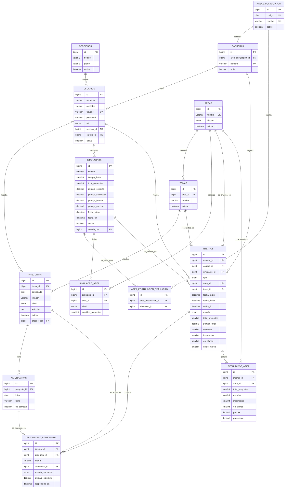

# Diseño de Base de Datos (versión 2)

**Proyecto:** Plataforma virtual de preparación académica para el ingreso a la educación superior
**Institución beneficiaria:** I.E. "Imperial CNI" – Cañete
**Ejecutor:** Estudiantes del VI ciclo de Ingeniería de Sistemas – Universidad Nacional de Cañete
**Documento:** `docs/base-de-datos/base-de-datos.md`
**Estado:** Versión preliminar (DER preliminar incluido)
**Documentos de referencia:** Requerimientos funcionales RF-01 a RF-16, requerimientos no funcionales RNF-01 a RNF-06 y *Diseño del backend con Laravel – Simulador virtual* (9 de octubre de 2026).

---

## 1. Objetivo y alcance

Este documento define el modelo de datos de la plataforma a partir de los requerimientos funcionales y no funcionales del sistema y del diseño del backend. Establece las entidades, sus campos, tipos de datos, claves primarias (PK) y foráneas (FK), relaciones (1:N y N:M), restricciones de integridad y el diagrama entidad-relación (DER).

Esta versión incorpora la estructura del examen de admisión (5 áreas de postulación, selección de carrera, 100 preguntas por simulacro y sistema de puntuación con penalización) y las garantías de cantidad de preguntas y variación de orden por estudiante.

El diseño está pensado para que **Laravel** cree las tablas mediante migraciones sobre **MariaDB**, y para ser administrado con **DBeaver**.

## 2. Tecnologías y convenciones

| Aspecto | Definición |
|---|---|
| Motor de base de datos | MariaDB (InnoDB, `utf8mb4`) |
| Herramienta de administración | DBeaver |
| Framework | Laravel con Eloquent; autenticación con Laravel Sanctum |
| Nombres de tablas | Minúsculas, `snake_case`, en español; los nombres coinciden con los del diseño del backend |
| Clave primaria | `id` (`BIGINT UNSIGNED`, autoincremental) |
| Clave foránea | `<entidad_singular>_id` (ej. `tema_id`) |
| Auditoría | `created_at` y `updated_at` (`TIMESTAMP`, nulos) en todas las tablas propias |
| Baja lógica | Campo `activo` (`BOOLEAN`, por defecto verdadero): usuarios y preguntas no se eliminan, se desactivan |

## 3. Cambios respecto a la versión anterior

| N° | Cambio | Motivo |
|---|---|---|
| 1 | Nuevas tablas `areas_postulacion` (Áreas A–E) y `carreras`; `usuarios` recibe `carrera_id` | Selección de carrera y área de postulación (RF-16) |
| 2 | Nueva tabla `area_postulacion_simulacro` (N:M) | Definir para qué áreas de postulación está abierto cada simulacro |
| 3 | `areas` recibe el campo `bloque` (habilidad verbal, habilidad lógico-matemática, conocimientos) | Distribución 15 / 15 / 70 del examen |
| 4 | Se elimina `simulacro_preguntas` | Cada estudiante recibe su propio sorteo de preguntas, guardado en `respuestas_estudiante` |
| 5 | `respuestas_intento` pasa a llamarse `respuestas_estudiante`; `simulacro_areas` pasa a `simulacro_area` | Coincidir con los nombres del diseño del backend |
| 6 | Puntajes por defecto: +20.000 correcta, −1.125 incorrecta, 0 en blanco o doble marca; puntaje máximo 2000.00 | Sistema de puntuación del examen |
| 7 | `respuestas_estudiante.estado_respuesta` (`correcta`, `incorrecta`, `en_blanco`, `doble_marca`) y `puntaje_obtenido` | Registrar la doble marca y el puntaje de cada pregunta |
| 8 | `intentos` recibe `carrera_id`, `area_id`, `total_preguntas` y `doble_marca`; el estado `enviado_automatico` pasa a `enviado_auto`; el rol `administrador` pasa a `admin` | Reportes por carrera, práctica por área y coherencia con el backend |
| 9 | `resultados_area` recibe `incorrectas`, `en_blanco` y `puntaje` | Desglose del puntaje por área |
| 10 | Cada pregunta tiene 4 alternativas (A a D) en lugar de 5; `alternativas.letra` pasa a `ENUM('A','B','C','D')` | Formato real del examen |

## 4. Estructura y reglas del examen

### 4.1. Áreas de postulación

El estudiante elige una carrera profesional y, a través de ella, queda asignado a una de las cinco áreas de selección.

| Código | Área de postulación |
|---|---|
| A | Ciencias de la Salud |
| B | Ciencias Básicas |
| C | Ingenierías |
| D | Ciencias Económicas y de la Gestión |
| E | Humanidades y Ciencias Jurídicas y Sociales |

### 4.2. Composición del examen

El examen completo tiene **100 preguntas**, que se organizan por bloque mediante el campo `areas.bloque`:

| Bloque (`areas.bloque`) | Preguntas | Contenido |
|---|---|---|
| `habilidad_verbal` | 15 | Comprensión de lectura e inglés |
| `habilidad_logico_matematica` | 15 | Habilidad lógico-matemática |
| `conocimientos` | 70 | Matemática, Ciencias y Letras |
| **Total** | **100** | |

Cada fila de `areas` pertenece a un solo bloque. La cantidad de preguntas de cada área dentro de un simulacro se define en `simulacro_area` (RF-07).

### 4.3. Sistema de puntuación

| Resultado de la respuesta | Puntaje por defecto | Campo del simulacro |
|---|---|---|
| Correcta | +20.000 | `puntaje_correcta` |
| Incorrecta | −1.125 (penalización) | `puntaje_incorrecta` |
| En blanco | 0.000 | `puntaje_blanco` |
| Doble marca | 0.000 (se trata como en blanco) | `puntaje_blanco` |

`puntaje_total = correctas × puntaje_correcta + incorrectas × puntaje_incorrecta + (en_blanco + doble_marca) × puntaje_blanco`

- **Puntaje máximo:** 100 × 20.000 = **2000.00**.
- **Puntaje mínimo teórico:** 100 × (−1.125) = −112.500.
- **Ejemplo:** 70 correctas, 20 incorrectas y 10 en blanco: 70 × 20 − 20 × 1.125 + 0 = **1377.500**.

Por la penalización de 3 decimales, los puntajes se almacenan como `DECIMAL(7,3)` o `DECIMAL(8,3)` con signo.

### 4.4. Garantía de cantidad de preguntas y variación del orden

1. **Cantidad exacta por estudiante.** Al iniciar un intento, el sistema sortea, por cada fila de `simulacro_area`, exactamente `cantidad_preguntas` preguntas activas distintas. El intento solo se crea si el sorteo completa el total del simulacro (100 en el examen completo); de lo contrario la operación se revierte y se responde con error 422.
2. **Banco suficiente.** Antes de habilitar un simulacro, el sistema verifica que cada área (y nivel, si no es `mixto`) tenga al menos `cantidad_preguntas` preguntas activas. Se recomienda mantener en el banco un margen de al menos el doble de preguntas por área, para que los estudiantes no reciban exactamente las mismas preguntas (consulta de verificación en la sección 10.2).
3. **Examen propio por estudiante.** Las preguntas sorteadas se guardan en `respuestas_estudiante` con la alternativa vacía, de modo que cada estudiante conserva su propio examen.
4. **Orden distinto por estudiante.** El campo `respuestas_estudiante.orden` se asigna de forma aleatoria en cada intento. Se mezclan las preguntas dentro de cada bloque y los bloques mantienen la secuencia habilidad verbal → habilidad lógico-matemática → conocimientos (ver supuestos, sección 13).
5. **Integridad.** `UNIQUE (intento_id, pregunta_id)` impide repetir una pregunta en un intento y `UNIQUE (intento_id, orden)` impide posiciones duplicadas. Al finalizar, el sistema comprueba que `COUNT(respuestas_estudiante) = intentos.total_preguntas`.

## 5. Trazabilidad de requerimientos

### 5.1. Requerimientos funcionales

| Código | Requerimiento | Tablas involucradas |
|---|---|---|
| RF-01 | Inicio de sesión | `usuarios`, `personal_access_tokens` |
| RF-02 | Gestión de usuarios | `usuarios` |
| RF-03 | Carga masiva de estudiantes | `usuarios`, `secciones` |
| RF-04 | Gestión de áreas y temas | `areas`, `temas` |
| RF-05 | Gestión del banco de preguntas | `preguntas`, `alternativas`, `temas` |
| RF-06 | Carga masiva de preguntas | `preguntas`, `alternativas`, `areas`, `temas` |
| RF-07 | Configuración de simulacros | `simulacros`, `simulacro_area`, `area_postulacion_simulacro` |
| RF-08 | Rendir simulacro | `intentos`, `respuestas_estudiante` |
| RF-09 | Cronómetro y envío automático | `intentos` (`fecha_inicio`, `fecha_limite`, `estado`) |
| RF-10 | Calificación automática | `simulacros` (puntajes), `respuestas_estudiante`, `intentos`, `resultados_area` |
| RF-11 | Resultados del intento | `intentos`, `resultados_area`, `respuestas_estudiante`, `preguntas`, `alternativas` |
| RF-12 | Historial del estudiante | `intentos` |
| RF-13 | Práctica por tema | `intentos` (`tipo = practica`), `respuestas_estudiante` |
| RF-14 | Reportes para docentes | `intentos`, `resultados_area`, `usuarios`, `secciones`, `carreras`, `respuestas_estudiante`, `temas` |
| RF-15 | Exportación de resultados | Consulta sobre `intentos`, `usuarios`, `carreras` y `resultados_area` |
| RF-16 | Selección de carrera y asignación del área de postulación | `usuarios`, `carreras`, `areas_postulacion` |

> RF-16 proviene del diseño del backend (módulo Usuarios, ruta `PUT /me/carrera`).

### 5.2. Requerimientos no funcionales con impacto en la base de datos

| Código | Tipo | Decisión de diseño |
|---|---|---|
| RNF-03 | Rendimiento | Índices en claves foráneas y en campos de consulta frecuente (sección 10.3). Soporte para 30 sesiones simultáneas. |
| RNF-04 | Seguridad y privacidad | Contraseña con hash (bcrypt). Solo se guardan nombres, apellidos, sección, carrera y resultados, conforme a la Ley N.º 29733. |
| RNF-05 | Disponibilidad | Cada respuesta se guarda al momento en `respuestas_estudiante`. Copia de seguridad semanal de la base de datos. |
| RNF-06 | Mantenibilidad | Estructura definida por migraciones de Laravel, nombres consistentes y versionado en GitHub. |

> RNF-01 (usabilidad) y RNF-02 (compatibilidad) corresponden a la interfaz y no generan estructuras de datos.

## 6. Resumen de entidades

| N° | Tabla | Descripción |
|---|---|---|
| 1 | `secciones` | Secciones del 5.º grado (A, B, C, D). |
| 2 | `areas_postulacion` | Las 5 áreas de selección (A a E). |
| 3 | `carreras` | Carreras profesionales, cada una dentro de un área de postulación. |
| 4 | `usuarios` | Administradores, docentes y estudiantes, diferenciados por rol. |
| 5 | `areas` | Áreas de contenido del examen, clasificadas por bloque. |
| 6 | `temas` | Temas que pertenecen a cada área. |
| 7 | `preguntas` | Banco de preguntas con nivel de dificultad y solución. |
| 8 | `alternativas` | Cuatro alternativas (A a D) por pregunta, con indicador de la correcta. |
| 9 | `simulacros` | Configuración general de cada simulacro (tiempo, puntajes, disponibilidad). |
| 10 | `area_postulacion_simulacro` | Áreas de postulación para las que está abierto un simulacro (N:M). |
| 11 | `simulacro_area` | Cantidad de preguntas por área y nivel que debe tener cada simulacro. |
| 12 | `intentos` | Cada simulacro rendido o práctica por tema/área realizada por un estudiante. |
| 13 | `respuestas_estudiante` | Preguntas sorteadas para el intento, en orden propio, con la respuesta marcada. |
| 14 | `resultados_area` | Aciertos, puntaje y porcentaje por área de cada intento finalizado. |

Además, Laravel Sanctum crea la tabla `personal_access_tokens` (tokens de sesión) mediante su propia migración.

## 7. Diccionario de datos

**Leyenda:** PK = clave primaria · FK = clave foránea · UQ = valor único · NN = obligatorio · NULL = opcional. Todas las tablas incluyen `created_at` y `updated_at` (`TIMESTAMP`, NULL), salvo indicación contraria.

### 7.1. `secciones`

| Campo | Tipo | Nulo | Restricciones | Descripción |
|---|---|---|---|---|
| `id` | BIGINT UNSIGNED | NN | PK, autoincremental | Identificador de la sección. |
| `nombre` | VARCHAR(10) | NN | — | Nombre de la sección (A, B, C, D). |
| `grado` | VARCHAR(20) | NN | Por defecto `5to` | Grado al que pertenece. |
| `activo` | BOOLEAN | NN | Por defecto `1` | Estado de la sección. |

Restricción adicional: `UNIQUE (nombre, grado)`.

### 7.2. `areas_postulacion`

| Campo | Tipo | Nulo | Restricciones | Descripción |
|---|---|---|---|---|
| `id` | BIGINT UNSIGNED | NN | PK, autoincremental | Identificador del área de postulación. |
| `codigo` | CHAR(1) | NN | UQ, valores A, B, C, D, E | Código del área. |
| `nombre` | VARCHAR(100) | NN | UQ | Nombre del área (ej. Ciencias de la Salud). |
| `activo` | BOOLEAN | NN | Por defecto `1` | Estado del área. |

Datos iniciales (seeder): A – Ciencias de la Salud; B – Ciencias Básicas; C – Ingenierías; D – Ciencias Económicas y de la Gestión; E – Humanidades y Ciencias Jurídicas y Sociales.

### 7.3. `carreras`

| Campo | Tipo | Nulo | Restricciones | Descripción |
|---|---|---|---|---|
| `id` | BIGINT UNSIGNED | NN | PK, autoincremental | Identificador de la carrera. |
| `area_postulacion_id` | BIGINT UNSIGNED | NN | FK → `areas_postulacion.id` | Área de postulación a la que pertenece. |
| `nombre` | VARCHAR(150) | NN | UQ | Nombre de la carrera profesional. |
| `activo` | BOOLEAN | NN | Por defecto `1` | Estado de la carrera. |

### 7.4. `usuarios`

| Campo | Tipo | Nulo | Restricciones | Descripción |
|---|---|---|---|---|
| `id` | BIGINT UNSIGNED | NN | PK, autoincremental | Identificador del usuario. |
| `nombres` | VARCHAR(100) | NN | — | Nombres. |
| `apellidos` | VARCHAR(100) | NN | — | Apellidos. |
| `usuario` | VARCHAR(50) | NN | UQ | Nombre de usuario para iniciar sesión. |
| `password` | VARCHAR(255) | NN | — | Contraseña cifrada (bcrypt). |
| `rol` | ENUM('admin','docente','estudiante') | NN | — | Rol que determina las opciones visibles (RF-01). |
| `seccion_id` | BIGINT UNSIGNED | NULL | FK → `secciones.id` | Sección del estudiante. Obligatoria solo si `rol = estudiante`. |
| `carrera_id` | BIGINT UNSIGNED | NULL | FK → `carreras.id` | Carrera elegida por el estudiante (RF-16). El área de postulación se obtiene a través de la carrera. |
| `activo` | BOOLEAN | NN | Por defecto `1` | Cuenta activa o desactivada (RF-02). |
| `remember_token` | VARCHAR(100) | NULL | — | Token de sesión de Laravel. |

### 7.5. `areas`

| Campo | Tipo | Nulo | Restricciones | Descripción |
|---|---|---|---|---|
| `id` | BIGINT UNSIGNED | NN | PK, autoincremental | Identificador del área. |
| `nombre` | VARCHAR(100) | NN | UQ | Nombre del área (Habilidad Verbal, Habilidad Lógico-Matemática, Matemática, Ciencias, Letras, etc.). |
| `bloque` | ENUM('habilidad_verbal','habilidad_logico_matematica','conocimientos') | NN | — | Bloque del examen al que pertenece (sección 4.2). |
| `activo` | BOOLEAN | NN | Por defecto `1` | Estado del área. |

Datos iniciales sugeridos (seeder): *Habilidad Verbal* (bloque `habilidad_verbal`; temas: Comprensión de lectura e Inglés), *Habilidad Lógico-Matemática* (bloque `habilidad_logico_matematica`) y las áreas *Matemática*, *Ciencias* y *Letras* (bloque `conocimientos`). Los temas de estas últimas los definen los docentes.

### 7.6. `temas`

| Campo | Tipo | Nulo | Restricciones | Descripción |
|---|---|---|---|---|
| `id` | BIGINT UNSIGNED | NN | PK, autoincremental | Identificador del tema. |
| `area_id` | BIGINT UNSIGNED | NN | FK → `areas.id` | Área a la que pertenece el tema. |
| `nombre` | VARCHAR(150) | NN | — | Nombre del tema. |
| `activo` | BOOLEAN | NN | Por defecto `1` | Estado del tema. |

Restricción adicional: `UNIQUE (area_id, nombre)`.

### 7.7. `preguntas`

| Campo | Tipo | Nulo | Restricciones | Descripción |
|---|---|---|---|---|
| `id` | BIGINT UNSIGNED | NN | PK, autoincremental | Identificador de la pregunta. |
| `tema_id` | BIGINT UNSIGNED | NN | FK → `temas.id` | Tema de la pregunta; el área se obtiene a través del tema. |
| `enunciado` | TEXT | NN | — | Texto de la pregunta. |
| `imagen` | VARCHAR(255) | NULL | — | Ruta de la imagen del enunciado (JPG o PNG, opcional). |
| `nivel` | ENUM('basico','intermedio','avanzado') | NN | — | Nivel de dificultad. |
| `solucion` | TEXT | NN | — | Solución breve que se muestra en los resultados (RF-11). |
| `activo` | BOOLEAN | NN | Por defecto `1` | Permite desactivar la pregunta sin eliminarla. |
| `creado_por` | BIGINT UNSIGNED | NULL | FK → `usuarios.id` | Docente o administrador que la registró. |

### 7.8. `alternativas`

| Campo | Tipo | Nulo | Restricciones | Descripción |
|---|---|---|---|---|
| `id` | BIGINT UNSIGNED | NN | PK, autoincremental | Identificador de la alternativa. |
| `pregunta_id` | BIGINT UNSIGNED | NN | FK → `preguntas.id` | Pregunta a la que pertenece. |
| `letra` | ENUM('A','B','C','D') | NN | — | Posición de la alternativa. |
| `texto` | VARCHAR(500) | NN | — | Contenido de la alternativa. |
| `es_correcta` | BOOLEAN | NN | Por defecto `0` | Indica si es la respuesta correcta. |

Restricción adicional: `UNIQUE (pregunta_id, letra)`. Cada pregunta debe tener exactamente 4 alternativas y una sola correcta (validado por la aplicación).

### 7.9. `simulacros`

| Campo | Tipo | Nulo | Restricciones | Descripción |
|---|---|---|---|---|
| `id` | BIGINT UNSIGNED | NN | PK, autoincremental | Identificador del simulacro. |
| `nombre` | VARCHAR(150) | NN | — | Nombre del simulacro. |
| `tiempo_limite` | SMALLINT UNSIGNED | NN | Mayor que 0 | Duración máxima en minutos (RF-09). |
| `total_preguntas` | SMALLINT UNSIGNED | NN | Por defecto `100` | Total de preguntas por intento; debe coincidir con la suma de `simulacro_area.cantidad_preguntas`. |
| `puntaje_correcta` | DECIMAL(7,3) | NN | Por defecto `20.000` | Puntos por respuesta correcta. |
| `puntaje_incorrecta` | DECIMAL(7,3) | NN | Por defecto `-1.125` | Puntos por respuesta incorrecta (valor negativo o cero). |
| `puntaje_blanco` | DECIMAL(7,3) | NN | Por defecto `0.000` | Puntos por respuesta en blanco o con doble marca. |
| `puntaje_maximo` | DECIMAL(8,2) | NN | Por defecto `2000.00` | Puntaje máximo posible (`total_preguntas × puntaje_correcta`). |
| `fecha_inicio` | DATETIME | NN | — | Inicio de la disponibilidad (RF-07). |
| `fecha_fin` | DATETIME | NN | Mayor que `fecha_inicio` | Fin de la disponibilidad. |
| `activo` | BOOLEAN | NN | Por defecto `1` | Estado del simulacro. |
| `creado_por` | BIGINT UNSIGNED | NULL | FK → `usuarios.id` | Docente o administrador que lo configuró. |

### 7.10. `area_postulacion_simulacro`

Tabla intermedia (N:M) con el nombre que Laravel espera por defecto para la relación `belongsToMany` entre `AreaPostulacion` y `Simulacro`.

| Campo | Tipo | Nulo | Restricciones | Descripción |
|---|---|---|---|---|
| `id` | BIGINT UNSIGNED | NN | PK, autoincremental | Identificador. |
| `area_postulacion_id` | BIGINT UNSIGNED | NN | FK → `areas_postulacion.id` | Área de postulación habilitada. |
| `simulacro_id` | BIGINT UNSIGNED | NN | FK → `simulacros.id` | Simulacro. |

Restricción adicional: `UNIQUE (area_postulacion_id, simulacro_id)`.

### 7.11. `simulacro_area`

Define cuántas preguntas de cada área y nivel se sortean para cada estudiante (RF-07).

| Campo | Tipo | Nulo | Restricciones | Descripción |
|---|---|---|---|---|
| `id` | BIGINT UNSIGNED | NN | PK, autoincremental | Identificador de la configuración. |
| `simulacro_id` | BIGINT UNSIGNED | NN | FK → `simulacros.id` | Simulacro configurado. |
| `area_id` | BIGINT UNSIGNED | NN | FK → `areas.id` | Área de contenido incluida. |
| `nivel` | ENUM('basico','intermedio','avanzado','mixto') | NN | Por defecto `mixto` | Nivel de las preguntas a sortear. |
| `cantidad_preguntas` | SMALLINT UNSIGNED | NN | Mayor que 0 | Número de preguntas del área. |

Restricción adicional: `UNIQUE (simulacro_id, area_id, nivel)`.

### 7.12. `intentos`

Registra los simulacros rendidos y las prácticas (RF-08, RF-13).

| Campo | Tipo | Nulo | Restricciones | Descripción |
|---|---|---|---|---|
| `id` | BIGINT UNSIGNED | NN | PK, autoincremental | Identificador del intento. |
| `usuario_id` | BIGINT UNSIGNED | NN | FK → `usuarios.id` | Estudiante que realiza el intento. |
| `carrera_id` | BIGINT UNSIGNED | NULL | FK → `carreras.id` | Carrera del estudiante al momento del intento (para reportes). |
| `simulacro_id` | BIGINT UNSIGNED | NULL | FK → `simulacros.id` | Simulacro rendido. Nulo en las prácticas. |
| `tipo` | ENUM('simulacro','practica') | NN | — | Tipo de intento. |
| `area_id` | BIGINT UNSIGNED | NULL | FK → `areas.id` | Área elegida en una práctica (RF-13). |
| `tema_id` | BIGINT UNSIGNED | NULL | FK → `temas.id` | Tema elegido en una práctica (RF-13). |
| `fecha_inicio` | DATETIME | NN | — | Momento de inicio, registrado por el servidor. |
| `fecha_limite` | DATETIME | NULL | — | Momento máximo de envío (`fecha_inicio` + `tiempo_limite`). Nulo en prácticas. |
| `fecha_fin` | DATETIME | NULL | — | Momento en que se envió o cerró. |
| `estado` | ENUM('en_curso','finalizado','enviado_auto') | NN | Por defecto `en_curso` | `enviado_auto` es el cierre por fin de tiempo (RF-09). |
| `total_preguntas` | SMALLINT UNSIGNED | NN | — | Preguntas sorteadas para este intento. |
| `puntaje_total` | DECIMAL(8,3) | NULL | — | Puntaje obtenido (RF-10); puede ser negativo. |
| `correctas` | SMALLINT UNSIGNED | NULL | — | Total de respuestas correctas. |
| `incorrectas` | SMALLINT UNSIGNED | NULL | — | Total de respuestas incorrectas. |
| `en_blanco` | SMALLINT UNSIGNED | NULL | — | Total de preguntas sin responder. |
| `doble_marca` | SMALLINT UNSIGNED | NULL | — | Total de preguntas con doble marca. |

### 7.13. `respuestas_estudiante`

Se crea un registro por cada pregunta sorteada al iniciar el intento. Mientras `alternativa_id` sea nulo, la pregunta está en blanco. Cada respuesta se guarda al momento de marcarla (RNF-05).

| Campo | Tipo | Nulo | Restricciones | Descripción |
|---|---|---|---|---|
| `id` | BIGINT UNSIGNED | NN | PK, autoincremental | Identificador. |
| `intento_id` | BIGINT UNSIGNED | NN | FK → `intentos.id` | Intento al que pertenece. |
| `pregunta_id` | BIGINT UNSIGNED | NN | FK → `preguntas.id` | Pregunta sorteada. |
| `orden` | SMALLINT UNSIGNED | NN | — | Posición aleatoria de la pregunta dentro del intento. |
| `alternativa_id` | BIGINT UNSIGNED | NULL | FK → `alternativas.id` | Alternativa marcada. Nulo si está en blanco o tiene doble marca. |
| `estado_respuesta` | ENUM('correcta','incorrecta','en_blanco','doble_marca') | NULL | — | Resultado de la calificación. Nulo hasta calificar; en la práctica se completa al responder (retroalimentación inmediata). |
| `puntaje_obtenido` | DECIMAL(7,3) | NULL | — | Puntos de la pregunta (por defecto +20.000, −1.125 o 0). |
| `respondida_en` | DATETIME | NULL | — | Momento de la última modificación de la respuesta. |

Restricciones adicionales: `UNIQUE (intento_id, pregunta_id)` y `UNIQUE (intento_id, orden)`.

### 7.14. `resultados_area`

| Campo | Tipo | Nulo | Restricciones | Descripción |
|---|---|---|---|---|
| `id` | BIGINT UNSIGNED | NN | PK, autoincremental | Identificador. |
| `intento_id` | BIGINT UNSIGNED | NN | FK → `intentos.id` | Intento evaluado. |
| `area_id` | BIGINT UNSIGNED | NN | FK → `areas.id` | Área evaluada. |
| `total_preguntas` | SMALLINT UNSIGNED | NN | — | Preguntas del área en el intento. |
| `aciertos` | SMALLINT UNSIGNED | NN | — | Respuestas correctas en el área (RF-11). |
| `incorrectas` | SMALLINT UNSIGNED | NN | — | Respuestas incorrectas en el área. |
| `en_blanco` | SMALLINT UNSIGNED | NN | — | Preguntas en blanco o con doble marca. |
| `puntaje` | DECIMAL(8,3) | NN | — | Puntaje obtenido en el área. |
| `porcentaje` | DECIMAL(5,2) | NN | Entre 0 y 100 | Porcentaje de aciertos del área. |

Restricción adicional: `UNIQUE (intento_id, area_id)`.

## 8. Relaciones entre tablas

| Tabla padre | Tabla hija | Cardinalidad | Clave foránea | Al eliminar |
|---|---|---|---|---|
| `secciones` | `usuarios` | 1:N | `usuarios.seccion_id` | RESTRICT |
| `areas_postulacion` | `carreras` | 1:N | `carreras.area_postulacion_id` | RESTRICT |
| `carreras` | `usuarios` | 1:N | `usuarios.carrera_id` | SET NULL |
| `carreras` | `intentos` | 1:N | `intentos.carrera_id` | SET NULL |
| `areas_postulacion` ↔ `simulacros` | `area_postulacion_simulacro` | **N:M** | `area_postulacion_id`, `simulacro_id` | CASCADE / CASCADE |
| `areas` | `temas` | 1:N | `temas.area_id` | RESTRICT |
| `temas` | `preguntas` | 1:N | `preguntas.tema_id` | RESTRICT |
| `preguntas` | `alternativas` | 1:N | `alternativas.pregunta_id` | CASCADE |
| `usuarios` | `preguntas` | 1:N | `preguntas.creado_por` | SET NULL |
| `usuarios` | `simulacros` | 1:N | `simulacros.creado_por` | SET NULL |
| `simulacros` | `simulacro_area` | 1:N | `simulacro_area.simulacro_id` | CASCADE |
| `areas` | `simulacro_area` | 1:N | `simulacro_area.area_id` | RESTRICT |
| `usuarios` | `intentos` | 1:N | `intentos.usuario_id` | RESTRICT |
| `simulacros` | `intentos` | 1:N | `intentos.simulacro_id` | RESTRICT |
| `areas` | `intentos` | 1:N | `intentos.area_id` | SET NULL |
| `temas` | `intentos` | 1:N | `intentos.tema_id` | SET NULL |
| `intentos` | `respuestas_estudiante` | 1:N | `respuestas_estudiante.intento_id` | CASCADE |
| `preguntas` | `respuestas_estudiante` | 1:N | `respuestas_estudiante.pregunta_id` | RESTRICT |
| `alternativas` | `respuestas_estudiante` | 1:N | `respuestas_estudiante.alternativa_id` | SET NULL |
| `intentos` | `resultados_area` | 1:N | `resultados_area.intento_id` | CASCADE |
| `areas` | `resultados_area` | 1:N | `resultados_area.area_id` | RESTRICT |

La eliminación física se evita en el uso normal: los registros se desactivan con el campo `activo`, de modo que el historial de intentos y resultados se conserve íntegro.

## 9. Diagrama entidad-relación (DER preliminar)



## 10. Reglas de integridad, consultas e índices

### 10.1. Reglas de negocio que valida la aplicación

1. Un usuario con `rol = estudiante` debe tener `seccion_id`. Debe elegir su carrera (`carrera_id`) antes de ver o rendir simulacros.
2. Cada pregunta activa debe tener exactamente 4 alternativas (A a D) y una sola con `es_correcta = 1`.
3. En un simulacro, `fecha_fin` debe ser posterior a `fecha_inicio`, `tiempo_limite` debe ser mayor que 0 y `total_preguntas` debe ser igual a la suma de `simulacro_area.cantidad_preguntas`. Para el examen completo, las áreas deben sumar 15 de `habilidad_verbal`, 15 de `habilidad_logico_matematica` y 70 de `conocimientos`.
4. `puntaje_correcta` debe ser mayor que 0, `puntaje_incorrecta` menor o igual que 0, y `puntaje_maximo` igual a `total_preguntas × puntaje_correcta` (2000.00 en el examen completo).
5. Los puntajes de un simulacro no pueden modificarse una vez que existen intentos asociados.
6. Un estudiante solo ve y puede iniciar simulacros abiertos para su área de postulación (`area_postulacion_simulacro`) y dentro de su rango de fechas.
7. El tiempo se controla desde el servidor: `fecha_limite = fecha_inicio + tiempo_limite`. Una respuesta recibida después del límite se rechaza, y el comando programado `intentos:cerrar-vencidos` cierra los intentos vencidos con `estado = enviado_auto`.
8. Un intento de tipo `simulacro` requiere `simulacro_id`; uno de tipo `practica` requiere `area_id` o `tema_id` y no tiene `fecha_limite`.
9. Al finalizar el intento, el sistema califica cada respuesta (`estado_respuesta` y `puntaje_obtenido`), calcula los totales del intento y genera las filas de `resultados_area`, todo dentro de una transacción (RF-10, RF-11).
10. Las contraseñas se guardan con hash y nunca se muestran ni se exportan (RNF-04).

### 10.2. Consulta de verificación del banco de preguntas

Devuelve las áreas de un simulacro cuyo banco no alcanza para el sorteo (si no devuelve filas, el banco es suficiente):

```sql
SELECT sa.area_id, sa.nivel, sa.cantidad_preguntas, COUNT(p.id) AS disponibles
FROM simulacro_area sa
JOIN temas t ON t.area_id = sa.area_id AND t.activo = 1
LEFT JOIN preguntas p ON p.tema_id = t.id AND p.activo = 1
     AND (sa.nivel = 'mixto' OR p.nivel = sa.nivel)
WHERE sa.simulacro_id = :simulacro_id
GROUP BY sa.id, sa.area_id, sa.nivel, sa.cantidad_preguntas
HAVING COUNT(p.id) < sa.cantidad_preguntas;
```

### 10.3. Índices recomendados (RNF-03)

| Tabla | Índice | Finalidad |
|---|---|---|
| `usuarios` | `UNIQUE (usuario)`, `INDEX (seccion_id)`, `INDEX (carrera_id)`, `INDEX (rol, activo)` | Inicio de sesión y reportes por sección y carrera. |
| `carreras` | `INDEX (area_postulacion_id)` | Listado de carreras por área de postulación. |
| `temas` | `INDEX (area_id)` | Listado de temas por área. |
| `preguntas` | `INDEX (tema_id, nivel, activo)` | Sorteo de preguntas por tema y nivel. |
| `alternativas` | `UNIQUE (pregunta_id, letra)` | Integridad de las 4 alternativas. |
| `intentos` | `INDEX (usuario_id, fecha_inicio)`, `INDEX (simulacro_id, estado)`, `INDEX (estado, fecha_limite)` | Historial (RF-12), reportes (RF-14) y cierre automático de intentos vencidos. |
| `respuestas_estudiante` | `UNIQUE (intento_id, pregunta_id)`, `UNIQUE (intento_id, orden)` | Guardado inmediato sin duplicados y orden propio por intento. |
| `resultados_area` | `UNIQUE (intento_id, area_id)`, `INDEX (area_id)` | Resultados por área y detección de temas débiles. |

### 10.4. Reportes

- **Temas con menor porcentaje de aciertos (RF-14):** se obtienen cruzando `respuestas_estudiante` con `preguntas` y `temas`, agrupando por tema y calculando el porcentaje de `estado_respuesta = 'correcta'`.
- **Resultados por carrera y área de postulación (RF-14):** se obtienen con `intentos.carrera_id` y `carreras.area_postulacion_id`.
- **Evolución del puntaje (RF-12):** se consulta `intentos` del estudiante ordenados por `fecha_inicio`.
- **Exportación a Excel (RF-15):** se genera a partir de `intentos`, `usuarios`, `secciones`, `carreras` y `resultados_area` filtrados por `simulacro_id`.

## 11. Script SQL de la base de datos (MariaDB)

El archivo `base-de-datos.sql` crea la base de datos `simulador_cni` con las 14 tablas descritas en este documento y carga los datos iniciales. Permite visualizar la estructura en DBeaver antes de implementar las migraciones de Laravel.

**Contenido del script:**

1. Creación de la base de datos con codificación `utf8mb4`.
2. Eliminación previa de las tablas (en orden inverso), para poder ejecutar el script más de una vez.
3. Creación de las 14 tablas con claves primarias, claves foráneas con sus acciones (`RESTRICT`, `CASCADE`, `SET NULL`), restricciones únicas, índices y comentarios por campo.
4. Restricciones `CHECK` a nivel de base de datos:
   - En `simulacros`: `tiempo_limite > 0`, `total_preguntas > 0`, `fecha_fin > fecha_inicio`, `puntaje_correcta > 0` y `puntaje_incorrecta <= 0`.
   - En `simulacro_area`: `cantidad_preguntas > 0`.
   - En `resultados_area`: `porcentaje` entre 0 y 100.
5. Datos iniciales: secciones A–D, las 5 áreas de postulación, las 5 áreas de contenido con su bloque y los temas Comprensión de lectura e Inglés.

**Para visualizar la estructura en DBeaver:**

1. Conectarse a MariaDB (versión 10.4 o superior).
2. Abrir `base-de-datos.sql` en el editor SQL y ejecutarlo completo (Alt + X).
3. Actualizar el navegador de bases de datos y hacer clic derecho sobre `simulador_cni` > **Ver diagrama**.

Pendientes que no incluye el script: el catálogo de carreras (`carreras`) y el usuario administrador inicial (`usuarios`).

## 12. Preparación para migraciones de Laravel

Orden recomendado de las migraciones, respetando las dependencias entre claves foráneas:

1. `secciones`
2. `areas_postulacion`
3. `carreras`
4. `usuarios` (y, a continuación, `personal_access_tokens` de Sanctum)
5. `areas`
6. `temas`
7. `preguntas`
8. `alternativas`
9. `simulacros`
10. `area_postulacion_simulacro`
11. `simulacro_area`
12. `intentos`
13. `respuestas_estudiante`
14. `resultados_area`

Observaciones para la implementación:

- Los modelos `AreaPostulacion` y `SimulacroArea` deben declarar `protected $table` (`areas_postulacion` y `simulacro_area`), porque Laravel pluralizaría otros nombres por defecto.
- La relación `belongsToMany` entre `Simulacro` y `AreaPostulacion` usa la tabla `area_postulacion_simulacro` sin configuración adicional.
- Los campos `ENUM` pueden definirse con `$table->enum()` o con `string` y validación en el modelo.
- Los datos iniciales (administrador, secciones, 5 áreas de postulación, carreras, áreas y temas base) se cargan con *seeders*.
- Se debe eliminar la migración `users` que trae Laravel por defecto, porque el proyecto usa `usuarios`; el modelo `Usuario` declara `protected $table = 'usuarios'`.
- La migración de Sanctum (`personal_access_tokens`) se publica con `php artisan vendor:publish --provider="Laravel\Sanctum\SanctumServiceProvider"` y debe ejecutarse después de crear `usuarios`.
- Los campos de puntaje usan `decimal('campo', 7, 3)` y `decimal('puntaje_total', 8, 3)`, con signo.

## 13. Supuestos y puntos por validar

1. **Examen propio por estudiante.** Las preguntas se sortean al iniciar cada intento y se guardan en `respuestas_estudiante`. Por eso se eliminó `simulacro_preguntas`; la relación `belongsToMany Pregunta` del modelo `Simulacro` en el diseño del backend debe quitarse o definirse a través de `respuestas_estudiante`.
2. **Orden de las preguntas.** Se asume que el orden se mezcla dentro de cada bloque y que los bloques mantienen su secuencia. Si debe mezclarse todo el examen, solo cambia la lógica del sorteo, no la estructura de datos.
3. **Distribución de los 70 puntos de conocimientos.** No se ha definido cuántas preguntas corresponden a Matemática, Ciencias y Letras, ni si cambia según el área de postulación. Se asume una sola distribución por simulacro; si varía por área, se crea un simulacro distinto para cada una (abierto solo a esa área mediante `area_postulacion_simulacro`).
4. **Catálogo de carreras.** Falta definir la lista de carreras de cada área y la universidad de referencia; se cargará mediante seeder.
5. **Doble marca.** Una interfaz web con una sola alternativa por pregunta normalmente no genera doble marca. El estado `doble_marca` queda previsto para respuestas cargadas desde hoja física o si la interfaz permite marcar más de una alternativa.
6. **Áreas A–E.** El diseño del backend menciona "área A–D" en `PUT /me/carrera`; debe corregirse a A–E.
7. **Valores del backend.** En el diseño del backend, la fórmula de la sección 7 indica p_c = 1 y p_i = 0 por defecto; deben actualizarse a 20.000 y −1.125. Además, el rol se llama `admin` y el estado de cierre automático `enviado_auto`, valores que este documento adopta.
8. **Tiempo límite.** No se ha indicado la duración del examen de 100 preguntas; se configura en `simulacros.tiempo_limite`.
9. **Prácticas.** Se guardan en el historial con `tipo = practica`; debe confirmarse si deben aparecer en los reportes del docente.
10. **Cuatro alternativas.** El examen usa 4 alternativas (A a D). El requerimiento RF-05 y el diseño del backend (`PreguntaRequest`, ruta `POST /preguntas`) mencionan 5 alternativas y deben actualizarse a 4, igual que la plantilla de Excel de carga masiva (RF-06).
11. **Penalización y puntaje negativo.** Se permite que `puntaje_total` sea negativo cuando las penalizaciones superan los puntos ganados. Debe confirmarse si el puntaje mínimo mostrado debe ser 0.
