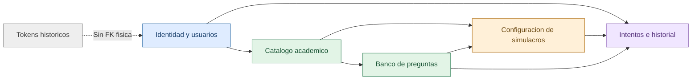

# Arquitectura profesional de datos · RSU-CNI

> **Fuente:** `develop` (`eb82cd46c35567c4b7d840a524a339e28c0f18ca`) · **Fecha:** 26/10/2026. **Estado:** esquema esperado en código; MariaDB compartida no consultada en vivo.

Se documentan 15 tablas, 138 columnas y 24 FK declaradas en migraciones. **No son un conteo verificado en la MariaDB instalada**.

## Índice de entregables

1. [Inventario de tablas y módulos](01-inventario.md)
2. [Diccionario completo, columna por columna](02-diccionario.md)
3. [FK, cardinalidades, índices, UNIQUE y CHECK](03-integridad.md)
4. [Auditoría de normalización, seguridad y recomendaciones](04-hallazgos.md)
5. [Consultas de comprobación SOLO LECTURA para MariaDB](05-auditoria-mariadb.md)
6. [ER general editable (Mermaid)](diagramas/general.mmd); por módulo: [identidad](diagramas/identidad.mmd), [banco](diagramas/banco.mmd), [simulacros](diagramas/configuracion.mmd), [resultados](diagramas/resultados.mmd), [tabla técnica](diagramas/tecnico.mmd)
7. [Diagrama coloreado de conexiones entre módulos](diagramas/modulos.mmd)
8. [Esquema íntegro DBML editable](esquema.dbml)

## Vista rápida de la arquitectura

## Decisiones de protección del backend

**Ninguna tabla, columna, migración, modelo, servicio, controlador, endpoint, plantilla o archivo de entorno ha sido modificado.** Los nombres reales `areas`, `area_postulacion_simulacro`, `simulacro_area`, `respuestas_estudiante`, etc., se mantienen intactos. La clasificación por dominio es solo documental: no se crean esquemas SQL nuevos ni se renombra para hacer el diagrama más bonito.

**Autenticación:** guard `web`, sesiones Laravel y roles `admin`, `docente`, `estudiante`; no se instala Spatie. `personal_access_tokens` es una tabla histórica y no debe eliminarse sin análisis. No se infiere que `sessions` o `password_reset_tokens` existan físicamente.

**Pendiente:** inspeccionar `information_schema` de MariaDB real, comprobar código A–E, migraciones aplicadas, vínculos históricos e índices. La CI valida MariaDB temporal, no datos del equipo. **No desplegar ni ejecutar seeders/migraciones sobre bases pobladas hasta contar con respaldo y aprobación.**
