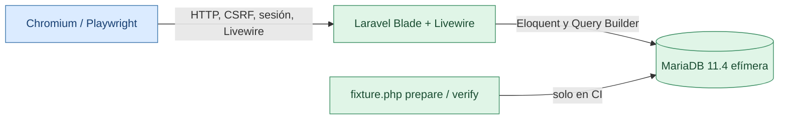

# Prueba integral RSU-CNI: frontend + backend + MariaDB

Esta prueba **abre Chromium real** en el runner de GitHub Actions. No se limita a hacer `php artisan test` ni a comprobar respuestas HTTP: hace clic en formularios Blade, interactúa con Livewire y verifica mediante consultas SQL que el navegador creó el intento y guardó la nota.

## Arquitectura de la verificación

**Se ejecuta automáticamente en PR contra `develop` cuando cambia código pertinente**, y puede lanzarse manualmente con `workflow_dispatch` desde Actions.

### Cobertura ejecutada por Chromium

1. Login desktop y móvil, carga real de CSS y captura de pantalla.
2. Admin autenticado: panel, formulario de preguntas y de simulacros.
3. Estudiante: cinco áreas A–E, elección de Ingeniería mediante HTML y CSRF.
4. Inicio de simulacro DEMO C con veinte preguntas; URL de intento generada por Laravel.
5. Respuesta elegida por botón Livewire, re-renderizado y progreso actualizado.
6. Finalización por modal Livewire; navegación al resultado por asignatura.
7. Docente de sección A: ve al estudiante calificado y la pantalla de calificaciones.
8. MariaDB: verifica catálogo, área elegida, sección, un intento, veinte preguntas únicas, una alternativa seleccionada, calificaciones, desglose y ausencia de respuestas cruzadas.
9. Detecta errores JavaScript y HTTP 5xx durante la navegación y comprueba desbordamiento horizontal en login, selección de áreas y panel alumno a 390 px.

### Aislamiento

- El workflow crea **MariaDB 11.4 temporal** llamada `cni_browser_ci`, se destruye al concluir el job; la única utilización de `migrate:fresh` es contra esa base efímera, **nunca sobre una instalación del equipo**.
- Se emplean únicamente `DatabaseSeeder` y `SimulacrosCincoAreasDemoSeeder`, y una clave **aleatoria no publicada** para los tres usuarios DEMO dentro del runner.
- Los scripts exigen `APP_ENV=testing`, `CNI_E2E_CI_ONLY=1`, host local y nombre de base exacto; fuera de ese entorno abortan sin actuar.
- Ambos flags CNI se activan **solo para CI**; no cambian ningún `.env` del repositorio ni ajustes de despliegue.
- GitHub Actions guarda capturas y logs durante siete días en el artefacto `cni-e2e-capturas-y-logs`.

### Límites

Una ejecución aprobada acredita el recorrido navegable en el Chromium del runner y la persistencia en una base temporal. **No certifica** un hosting externo, todas las resoluciones, calidad estética subjetiva, accesibilidad WCAG completa ni futuras configuraciones de MariaDB. La inspección visual de las capturas sigue siendo útil; cualquier fallo se investiga desde el artefacto de GitHub Actions.

**Archivos**: [workflow](../../.github/workflows/e2e-browser.yml) · [Chromium](../../tests/e2e/browser.mjs) · [verificación SQL](../../tests/e2e/fixture.php).
